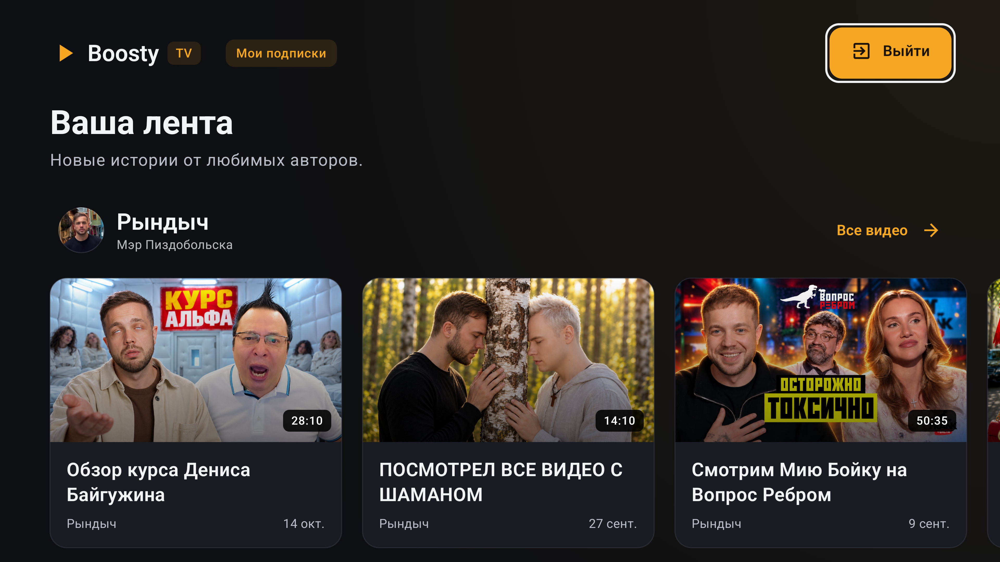
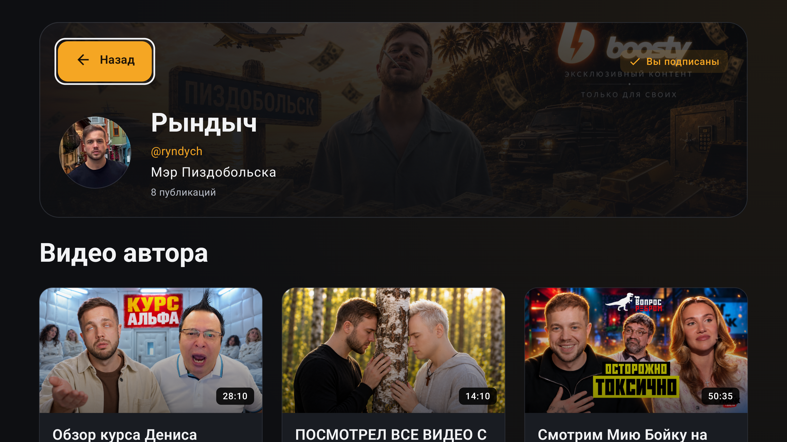
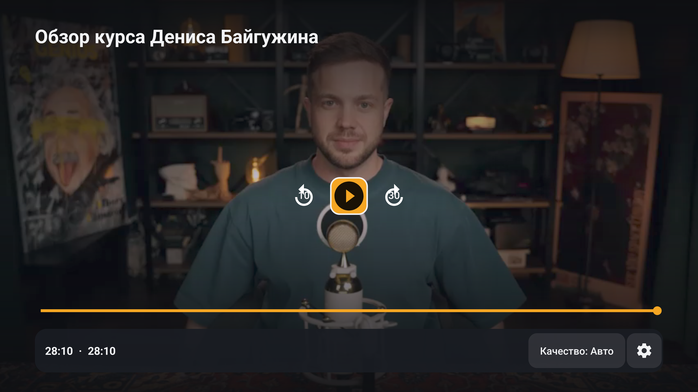
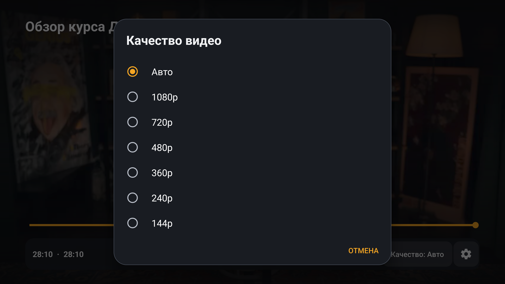
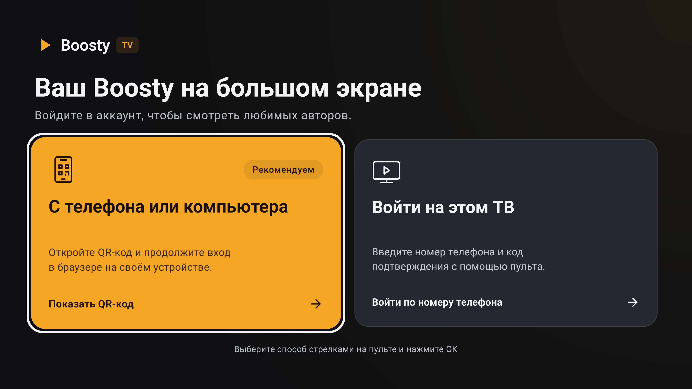
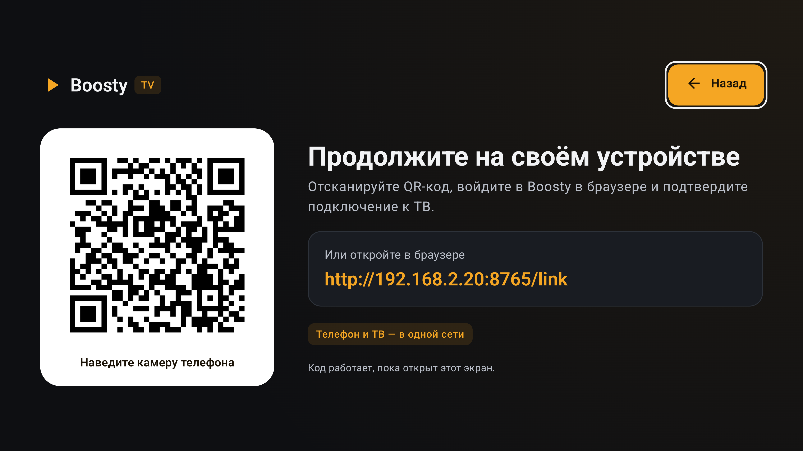
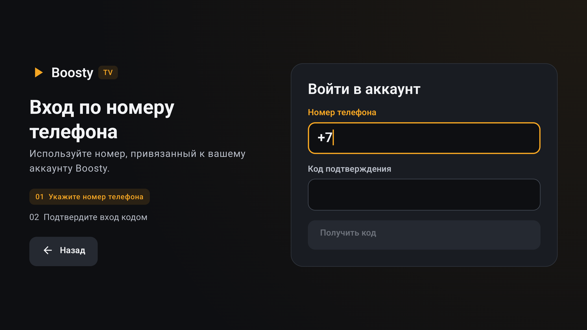

# Boosty TV

**Видео ваших авторов — на большом экране.**

Неофициальный клиент Boosty для Android TV: ваши подписки, видеопубликации
и удобный просмотр с обычным пультом. Крупные карточки, тёмная тема
и сохранение позиции просмотра. Поддерживается Android TV с Android 6.0.

> **НЕОФИЦИАЛЬНЫЙ КЛИЕНТ.** Проект разрабатывается независимо от Boosty
> и не является официальным приложением сервиса. Для просмотра платных
> публикаций нужна соответствующая подписка в вашем аккаунте.

## Возможности

- Лента видеопубликаций из ваших подписок и отдельные страницы авторов.
- Полноэкранный плеер с паузой, перемоткой, выбором качества и скорости.
- Продолжение незавершённого видео с сохранённого на телевизоре места.
- Вход через QR с телефона или компьютера, в том числе с аккаунтом Google.
- Вход по номеру телефона и коду подтверждения прямо на ТВ.

**Управление:** стрелки перемещают фокус, **OK** выбирает элемент,
**Назад** возвращает к предыдущему экрану.

## Скриншоты

| Страница автора | Видеоплеер |
|---|---|
|  |  |

| Выбор качества | Выбор способа входа |
|---|---|
|  |  |

| Подключение через QR | Вход по номеру телефона |
|---|---|
|  |  |

## Как войти через QR

Телефон или компьютер и телевизор должны находиться **в одной домашней сети**.

1. На ТВ выберите **«С телефона или компьютера»** и отсканируйте QR.
   На компьютере можно открыть показанный на ТВ адрес вручную.
2. На странице подключения **один раз сохраните закладку Boosty TV**.
   На компьютере перетащите одноимённую кнопку на панель закладок.
   На телефоне скопируйте адрес закладки и вставьте его целиком в поле URL
   созданной закладки — страница покажет инструкцию для вашего браузера.
3. Запустите сохранённую закладку на странице подключения:
   появится **«Закладка работает»**.
4. Нажмите **«Открыть Boosty»** и войдите в свой аккаунт.
   После входа вернитесь на страницу подключения и нажмите эту кнопку ещё раз.
5. На открытой вкладке Boosty запустите сохранённую закладку **Boosty TV**.
   Браузер вернётся на страницу подключения.
6. Нажмите **«Передать на ТВ»**. После подтверждения телевизор откроет подписки.

**В Android Chrome:** запускайте закладку из адресной строки — введите
**Boosty TV** и выберите подсказку со звёздочкой и адресом `javascript:`.
Не нажимайте Enter: он запускает поиск.

Сохранять закладку заново при следующих входах не нужно. Экран QR на телевизоре
должен оставаться открытым до завершения подключения.

## Вход по номеру телефона

Выберите **«Войти на этом ТВ»**, введите номер, привязанный к аккаунту Boosty,
и нажмите **«Получить код»**. Введите шестизначный код и нажмите **«Войти»**.
Если требуется CAPTCHA, используйте вход через QR и браузер.

## Ограничения

Приложение предназначено для просмотра видео. Поиск, комментарии, уведомления
и полноценный просмотр текстовых публикаций пока не реализованы.

## В планах релиза

1. Поиск по каналу.
2. Просмотр комментариев.
3. Просмотр на Apple TV.
